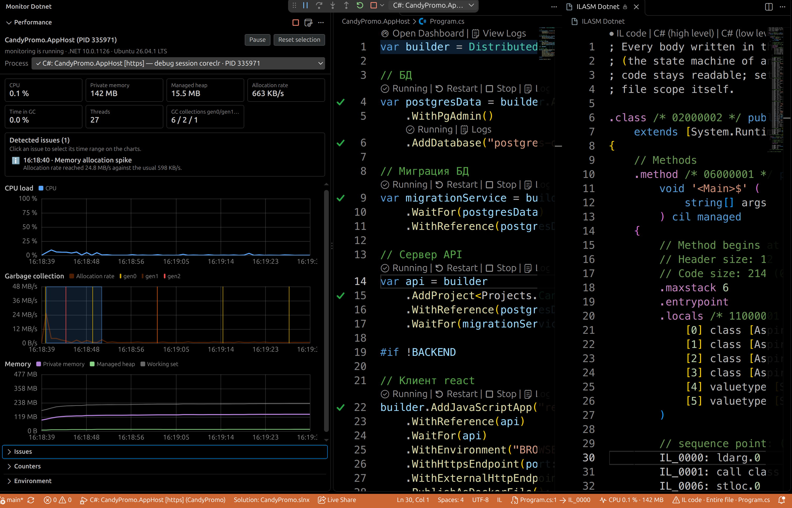

<p align="center">
  
</p>

<h1 align="center">🔍 Monitor Dotnet</h1>


> 📊 **Мониторинг .NET-приложений в реальном времени прямо в VS Code** — загрузка CPU, память, сборка мусора, счётчики, метрики и переменные окружения.
> Монитор открывается сам при запуске отладки. Никаких внешних панелей и сервисов — всё работает локально.

🇬🇧 English version: [README.md](README.md) · 📋 История изменений: [CHANGELOG.ru.md](CHANGELOG.ru.md)

<p align="center">
  
</p>

---

## ✨ Возможности

| | Возможность | Что получаете |
| --- | --- | --- |
| 📈 | **Графики производительности** | Загрузка CPU, сборка мусора и память рисуются на canvas в реальном времени |
| 🗑️ | **Лента сборок GC** | Отметки сборок с цветом по поколению, причиной и длительностью паузы |
| 🧮 | **Анализ диапазона** | Протяните мышью по графику — получите мин / сред / макс, число сборок и среднюю паузу |
| 🩺 | **Автопоиск проблем** | Подозрительные интервалы находятся сами: нативным списком и полосами на графиках |
| 🧾 | **EventCounters** | Классические счётчики .NET, сгруппированные по провайдерам |
| 📐 | **Метрики** | Инструменты `System.Diagnostics.Metrics`, сгруппированные по метрам |
| 🌱 | **Окружение** | Переменные окружения и системные свойства процесса |
| 🐞 | **Связка с отладкой** | Мониторинг запускается сам при отладке .NET-приложения: `coreclr`, C# Dev Kit и Aspire |
| 🎯 | **Выбор процесса** | Когда приложений запущено несколько, вы выбираете, какой процесс мониторить |
| 🔌 | **Подключение к процессу** | Подключение к любому запущенному процессу .NET в два клика |
| 🧵 | **Стек вызовов** | Мгновенный снимок стека вызовов работающего процесса |
| 💾 | **Снимок памяти** | GCDump с показом файла в проводнике |
| ⏺️ | **Профилирование** | Запись профиля `dotnet-trace` в формате Speedscope |
| 🌍 | **Два языка** | Английский и русский по языку интерфейса VS Code |
| 📟 | **Статус-бар** | Загрузка CPU и приватная память всегда на виду |

---

## ✅ Требования

| | Требование | Зачем нужно |
| --- | --- | --- |
| 🖥️ | **VS Code 1.100 или новее** | Используемые API webview, локализации и деревьев. Минимум проверяется сборкой: `@types/vscode` зафиксирован на 1.100.0, поэтому использование более нового API приводит к ошибке типов |
| 🟣 | **Среда выполнения .NET 10** | Встроенный мост, читающий EventPipe, собран под `net10.0` и запускается через `dotnet`. Команда `dotnet` должна быть в `PATH`, иначе укажите `monitor-dotnet.dotnetPath` |
| 🔬 | `dotnet-stack`, `dotnet-gcdump`, `dotnet-trace` *(необязательно)* | Нужны для снимка стека, снимка памяти и профилирования. Отсутствующее средство расширение предложит установить одной командой |

Для проектов Aspire нужен установленный Aspire CLI: хост AppHost запускает именно он. Расширение Aspire для VS Code не обязательно — мониторинг подключается к тому же процессу, что и отладчик.

Отлаживаемое приложение не обязано быть на .NET 10: EventPipe доступен начиная с .NET Core 3.0, поэтому .NET 5 и новее тоже подходят.
Поддерживаются Windows, Linux и macOS — приватная память, переменные окружения и командная строка читаются через системные API. Mono и Unity не поддерживаются.

---

## 🚀 Быстрый старт

1. 📦 Установите расширение (локальная сборка — в разделе **Сборка из исходников**).
2. ⌨️ Нажмите `F5` в любом .NET-проекте или выполните команду **Monitor Dotnet: Запустить мониторинг**.
3. 📊 В панели активности появится **Monitor Dotnet** с графиками и счётчиками.

---

## 🐞 Связка с отладкой

| Как запускается приложение | Тип сессии отладки | Какой процесс мониторится |
| --- | --- | --- |
| Запуск сборки через `coreclr` (`App.dll`) | `coreclr` | Процесс приложения (apphost или хост `dotnet`) |
| Запуск проекта C# Dev Kit (в конфигурации `projectPath`) | `dotnet` | Процесс приложения, а не обёртка `dotnet run` |
| Хост Aspire (`aspire run` под отладкой) | `aspire` | Процесс **AppHost** — тот же, к которому подключён отладчик. Сервисы, поднятые Aspire, автоматически не мониторятся: подключитесь к нужному через **Подключение к процессу .NET…** |

Сессии других .NET-типов (`clr` для .NET Framework, `dotnet-core`) тоже распознаются.
В решении Aspire дашборд, оркестратор и командная строка никогда не предлагаются как цели.

**Проекты на F# работают так же**: Ionide отлаживает их через сессию `coreclr` и указывает в `program`
собранную сборку, а процесс приложения находится по тем же признакам. Расширение `.fsproj` понимается
везде, где можно передать файл проекта. Само профилирование идёт на уровне рантайма — мост читает
EventPipe, — поэтому язык приложения не важен.

---

## 🎯 Выбор процесса

Когда приложений запускается несколько — хост Aspire со своими сервисами или связка проектов — вы сами
выбираете, какой процесс мониторить. Список **Процесс** в шапке панели показывает всё запущенное:

| Где находится список | Что показывает |
| --- | --- |
| Выпадающий список в панели Performance | Сначала сессии отладки, затем остальные процессы .NET; текущая цель отмечена галочкой |
| Команда **Monitor Dotnet: Выбрать процесс для мониторинга…** в палитре команд (или кнопка в заголовке панели) | Тот же список с PID и командной строкой: можно подключиться и к процессу, запущенному без отладчика |

Найденный процесс сессии запоминается, поэтому переключение мгновенное. Мониторинг никогда не
переключается сам: когда стартует вторая сессия отладки, продолжается мониторинг первой, а расширение
предлагает переключиться. Когда мониторимая сессия завершается, расширение предлагает другой процесс.

---

## 📊 Панель Performance

Три графика обновляются раз в секунду, сверху — плитки текущих значений.

| График | Что показывает |
| --- | --- |
| 📈 **Загрузка CPU** | Использование процессора приложением; 100 % — все ядра загружены полностью |
| 🗑️ **Сборка мусора** | Скорость выделения памяти и отметки каждой сборки: цвет — поколение, в подсказке — причина и пауза |
| 🧠 **Память** | Приватная память (заливка), управляемая куча и рабочий набор |

| Действие | Результат |
| --- | --- |
| 🖱️ Наведение | Подсказка со значениями всех рядов и сведениями о сборках в этой точке |
| ↔️ Протяжка мышью | Выделение диапазона времени; ниже появляется сводка: мин / сред / макс, число сборок, средняя пауза |
| ⌨️ `Esc` или двойной щелчок | Сброс выделения |
| ⏸️ Пауза | Остановить обновление, чтобы рассмотреть данные; **Продолжить** подтягивает свежий снимок |

Цвета берутся из текущей темы — светлой, тёмной или контрастной.

### 🩺 Автопоиск проблем

Расширение само следит за графиками и отмечает подозрительные интервалы:

| Проблема | Когда сообщается |
| --- | --- |
| 🔥 **Перегрузка CPU** | Загрузка держалась на 90 % и выше несколько обновлений подряд |
| 🗑️ **Долгая пауза GC** | Единичная пауза от 100 мс, от 300 мс — критично |
| 🌊 **Давление сборщика мусора** | 10 и более сборок и от 200 мс пауз внутри 10-секундного окна |
| 📈 **Всплеск выделений** | Скорость выделения втрое выше медианы сессии и не менее 1 МБ/с |

Каждая проблема получает цветную полосу на нужном графике и строку в списке над графиками: значок
важности (ℹ️ информация, ⚠️ предупреждение, 🔴 критично), момент начала и короткое пояснение. Нажмите на
строку — интервал выделится, графики расширятся до него, а снизу появится сводка по диапазону. Полностью
отключается настройкой `monitor-dotnet.enableIssueDetection`.

Тот же список есть в нативной панели **Проблемы** рядом с графиками: значок темы по важности и интервал в
описании. Она работает и с закрытыми графиками — нажатие на проблему открывает графики и выделяет интервал.

Список — это отчёт о прогоне, а не срез текущих данных. Проблемы хранятся по процессам: панель графиков
и её полосы всегда относятся к процессу, показанному на графиках, а панель **Проблемы** ведёт историю и
группирует её по процессам (имя и PID, мониторимый помечен и раскрыт первым).

Вместе с каждой проблемой сохраняются и её данные. Если живые графики уже ушли вперёд или интервал
относится к другому процессу, нажатие на проблему показывает сохранённый интервал: графики рисуются по
сохранённым точкам с запасом по краям, нужный диапазон отмечен полосой, а сводка снизу даёт мин / сред /
макс и данные по сборкам мусора. Полоса сверху называет процесс и предлагает **Вернуться к текущим данным**.
Так старую проблему всё ещё можно разобрать; теряются только точки, которые не были собраны. Следующая
сессия отладки начинает список заново, а команда **Очистить собранные данные** забывает его вместе с
данными.

---

## 🔢 Счётчики и метрики

Панель **Счётчики** показывает два вида данных:

- 🧾 **EventCounters** — классические счётчики, сгруппированные по провайдерам (`System.Runtime`, `Microsoft.AspNetCore.Hosting`, ваш собственный `EventSource`)
- 📐 **Метрики** — инструменты `System.Diagnostics.Metrics` по метрам, включая ряды с тегами

Что собирать, задаётся в настройках:

```jsonc
"monitor-dotnet.counterProviders": [
  "System.Runtime",                  // все счётчики провайдера
  "MyProvider[Counter1,Counter2]"    // только перечисленные счётчики
],
"monitor-dotnet.metricProviders": ["*"]  // все метры, либо "MyMeter", либо "MyMeter\\MyInstrument"
```

---

## 🌱 Окружение

Панель **Окружение** показывает, с чем было запущено приложение:

- 🔤 переменные окружения процесса
- 🖥️ системные свойства: версия .NET, флаги запуска, командная строка, ОС, разрядность
- 🔍 фильтр по имени или значению и копирование значения в буфер обмена

---

## 🛠 Профилирование по требованию

Кнопки в заголовке панели Performance:

| Кнопка | Инструмент | Результат |
| --- | --- | --- |
| 🧵 **Собрать стек вызовов** | `dotnet-stack` | Стек вызовов всех потоков в новой вкладке редактора |
| 💾 **Снять снимок памяти (GCDump)** | `dotnet-gcdump` | Файл `.gcdump` с показом в проводнике |
| ⏺️ **Начать / остановить профилирование** | `dotnet-trace` | Файл `.nettrace` в формате Speedscope |

Если инструмента нет, расширение предложит установить его одной командой (`dotnet tool install --global …`).

---

## ⚙️ Настройки

| Настройка | По умолчанию | Описание |
| --- | --- | --- |
| `monitor-dotnet.enableMonitoring` | `onDebugOrRun` | Когда запускать мониторинг: `onDebugOrRun`, `onDebug`, `never` |
| `monitor-dotnet.autoReveal` | `true` | Открывать панель при старте отладки |
| `monitor-dotnet.refreshIntervalSeconds` | `1` | Период обновления счётчиков и метрик |
| `monitor-dotnet.chartWindowSeconds` | `120` | Сколько секунд данных показывать на графиках |
| `monitor-dotnet.enableIssueDetection` | `true` | Искать подозрительные интервалы на графиках |
| `monitor-dotnet.counterProviders` | базовый набор .NET | Провайдеры EventCounters |
| `monitor-dotnet.metricProviders` | `["*"]` | Фильтры метров |
| `monitor-dotnet.dotnetPath` | `dotnet` | Путь к исполняемому файлу `dotnet` |
| `monitor-dotnet.bridgePath` | пусто | Сборка моста; пусто — встроенная копия |
| `monitor-dotnet.processNameFilter` | пусто | Дополнительная подстрока для поиска процесса отладки |
| `monitor-dotnet.profilingOutputDirectory` | пусто | Куда складывать профили и снимки памяти |

---

## 🌍 Языки

Расширение говорит на языке интерфейса VS Code.

- 🇬🇧 **Английский** — исходный язык всех строк
- 🇷🇺 **Русский** — полный перевод

| Что | Где лежит перевод |
| --- | --- |
| Строки кода: уведомления, подсказки, журнал | `l10n/bundle.l10n.<язык>.json` |
| Манифест: команды, панели, настройки | `package.nls.<язык>.json` |
| Панель графиков (webview) | тексты передаёт расширение вместе с данными |

---

## 🏗️ Как это устроено

```
┌────────────────────────── VS Code ──────────────────────────┐
│  Расширение Monitor Dotnet (TypeScript)                      │
│                                                              │
│  extension.ts ──► MonitorController ──► процесс моста        │
│                        │                    │ NDJSON (stdout)│
│                        ▼                    ▼                │
│  MonitorState (ряды, счётчики, метрики)    BridgeLocator     │
│            │                                                 │
│            ├─► панель Performance  (графики на canvas)       │
│            ├─► панель Счётчики     (дерево)                  │
│            ├─► панель Окружение    (дерево)                  │
│            └─► статус-бар          (CPU и память)            │
└──────────────────────────────────────────────────────────────┘
                              ▲
                              │ одно JSON-сообщение на строку
                              ▼
┌─────────── Мост (MonitorDotnet.Bridge, .NET 10) ─────────────┐
│  Сессия EventPipe:                                           │
│   • EventCounters                  → счётчики провайдеров    │
│   • System.Diagnostics.Metrics     → метры                   │
│   • Microsoft-Windows-DotNETRuntime → события GC, размеры куч│
│  Операционная система: приватная память, окружение, командная строка    │
└──────────────────────────────────────────────────────────────┘
```

Расширение VS Code не может читать EventPipe напрямую, поэтому сбор идёт в отдельном процессе .NET:
он подключается к целевому процессу, разбирает поток событий и отдаёт расширению готовые срезы.

---

## 📁 Структура проекта

| Путь | Назначение |
| --- | --- |
| `src/core` | Логика без зависимости от VS Code: протокол, состояние, форматирование, данные графиков, поиск процесса отладки |
| `src/monitor` | Жизненный цикл моста, поиск процессов .NET, обёртки инструментов профилирования |
| `src/views` | Панели: Performance (провайдер webview), Счётчики и Окружение (деревья), статус-бар |
| `src/webview` | Код внутри webview: отрисовка графиков на canvas и обмен сообщениями |
| `src/extension.ts` | Активация, команды, реакция на сессии отладки, контекстные ключи |
| `bridge/MonitorDotnet.Bridge` | Мост на .NET 10: сессия EventPipe, разбор событий, статистика процесса |
| `bridge/MonitorDotnet.Bridge.Tests` | Тесты моста, включая сквозной прогон на реальном процессе |
| `samples/SampleApp` | Демонстрационное приложение со счётчиками, метриками и нагрузкой |
| `samples/WebApi` | Веб-приложение ASP.NET Core для проверки запуска через `coreclr` и C# Dev Kit |
| `samples/AspireApp` | Хост Aspire с одним сервисом для проверки сессии отладки типа `aspire` |
| `scripts/build.ts` | Сборка расширения и бандла панели графиков через esbuild |
| `l10n`, `package.nls.*` | Словари переводов |
| `test` | Тесты расширения: активация, локализация, сквозной поток данных |

---

## 🧪 Сборка из исходников

Нужны **.NET SDK 10**, **Node.js 20+** и **VS Code 1.100+**.

```bash
npm install
npm run bridge:build   # публикация моста в media/bridge и dist/bridge
npm run build          # сборка расширения и панели графиков
npm run package        # создание monitor-dotnet-1.0.0.vsix
code --install-extension monitor-dotnet-1.0.0.vsix
```

Полезные команды:

| Команда | Что делает |
| --- | --- |
| `npm run watch` | Пересобирает расширение и панель при изменениях |
| `npm run typecheck` | Проверка типов TypeScript 7 (расширение и webview отдельно) |
| `npm test` | Тесты расширения, включая согласованность словарей |
| `npm run test:bridge` | Тесты моста на xunit |
| `MONITOR_DOTNET_E2E=1 npm test` | Сквозные проверки на реальных процессах: `samples/SampleApp --stress` (графики и автопоиск проблем), а также `samples/WebApi` и `samples/AspireApp` для типов сессий отладки. Проверке перегрузки CPU нужен свободный компьютер: на занятом она сообщает, что нагрузка не достигла порога, вместо падения |

---

## 🔐 Приватность

- 🚫 Никакой телеметрии, учётных записей и отправки данных: расширение собирает всё локально и никуда не передаёт. Сеть используется только с вашего подтверждения — установка средства диагностики командой `dotnet tool install` или открытие [документации по диагностике .NET](https://learn.microsoft.com/dotnet/core/diagnostics/).
- 🏠 Все данные собираются локально процессом моста и показываются только внутри VS Code.
- 🗂️ Профили и снимки памяти сохраняются туда, куда вы указали (по умолчанию — во временный каталог).

---

## 📄 Лицензия

**MIT** — полный текст в [LICENSE](LICENSE). © 2026 Дмитрий Сорокин (dimanrus).